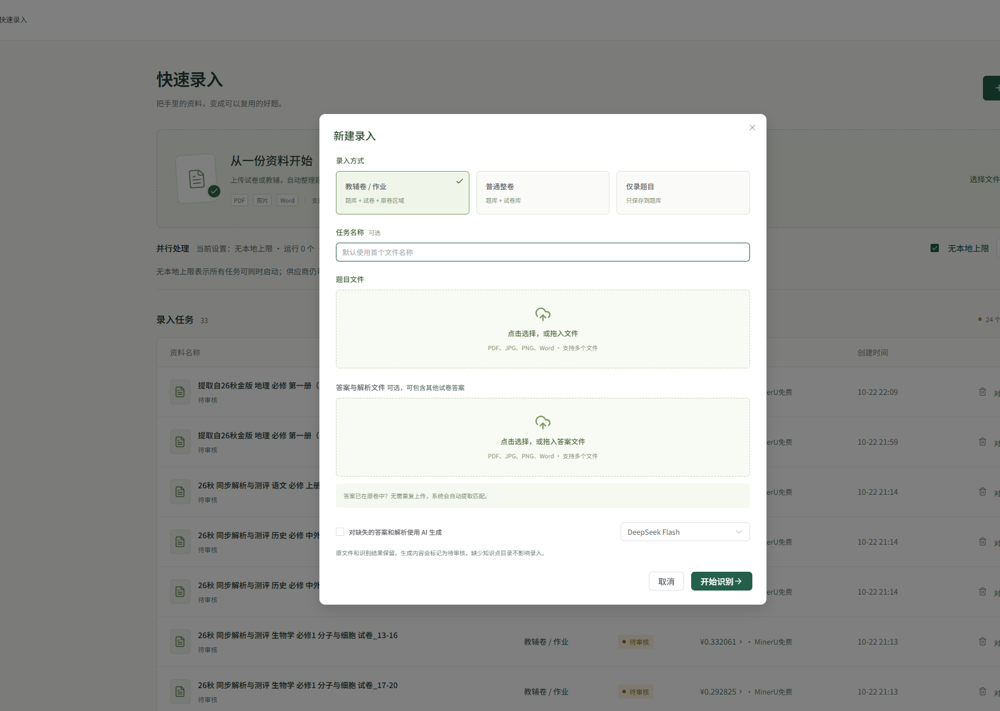
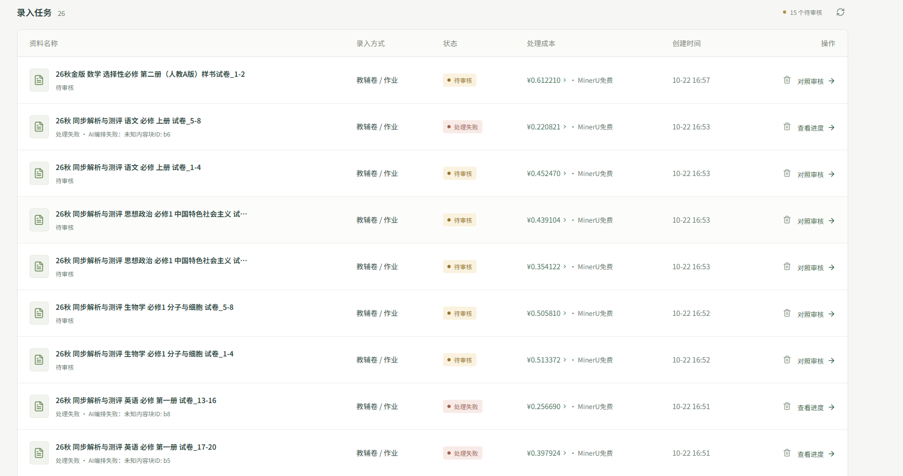
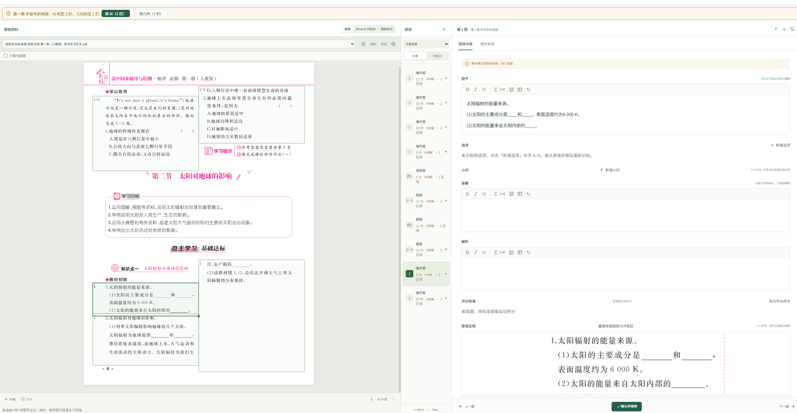

# 快速录入 · 快速上手

把手里的试卷 / 教辅 / 课时作业变成可复用的题目。

## 五步完成

### 1. 新建录入

点右上角「新建录入」，选择录入方式，上传资料：

- **教辅卷/作业**：题目 + 答案 + 原卷区域（最常用）
- **普通整卷**：整卷入库
- **仅题目**：只保存题目

有答案文件就一起传；答案在原卷里的，不用重复传。

### 2. 等待处理

任务会依次经过：MinerU 识别 → 数据整理 → AI 编排 → 答案匹配 → 待审核。

可以离开页面，任务保存在服务器，回来继续。

### 3. 打开对照审核

任务列表里点「对照审核」：

### 4. 逐题核对

左边是原卷，中间是题目列表，右边是题目内容：

重点看：题框是否框对、题干是否完整、选项/小问/答案是否齐全。没问题点「确认并继续」。

### 5. 审核入库

全部核对后点「审核入库」，题目进入题库/试卷库。

## 三个最常用的小技巧

1. **题框不对**：直接在左侧原卷拖动框边调整；缺框点「补框」。
2. **处理失败**：回任务点「恢复处理」，已完成的阶段不会重跑。
3. **区域图片**：框好区域后可以「复制图片」或「插入到」题干、答案、解析、小问。

## 遇到问题

打开 `详细手册.md`，把你的问题描述 + 页面上的提示文字发给 AI，AI 会按手册告诉你点哪里。
