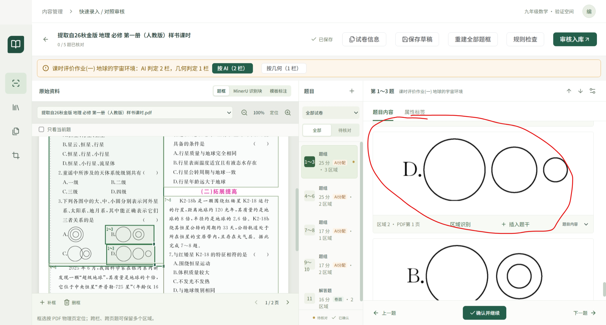

# 快速录入 · 详细手册（给 AI 排查用）

> 用法：把遇到的问题 + 界面提示原文发给 AI，并让 AI 按本手册作答。
> 每条按「症状 → 原因 → 操作步骤」组织，步骤里的按钮文字与界面一致。

## 通用约定

- 左侧：原卷（可拖动、补框、缩放）
- 中间：题目列表（全部 / 待核对）
- 右侧：题目内容（题干、选项、小问、答案、解析、填空答案、评分标准、原卷区域）
- 顶部：保存草稿 / 重建全部题框 / 规则检查 / 审核入库

---

## 问题：题框位置不对、盖住下一题、框太大或太小

症状关键词：框偏了、框太大、框盖住下一题、框没包住图

步骤：
1. 左侧原卷区，拖动框的边或角调整；
2. 缺框：点左下角「补框」，在原卷上拖出新区域；
3. 整个任务题框都乱：点顶部「重建全部题框」；
4. 分栏明显不对：见「问题：分栏判断错误」。

## 问题：分栏判断错误（一栏/两栏/三栏）

症状关键词：AI 判定 X 栏、几何判定 Y 栏、按 AI、按几何

步骤：
1. 审核页顶部会出现黄色提示条：「AI 判定 N 栏，几何判定 M 栏」；
2. 点「按 AI（N 栏）」或「按几何（M 栏）」，系统会按所选栏数重建题框；
3. 选完保存草稿。

说明：AI 与几何冲突时才会出现该提示；没有提示表示两者一致。

## 问题：漏题 / 多题 / 题目切多了

症状关键词：漏题、少了一道题、多了一道题、题干混在一起

步骤：
1. 漏题：题目列表上方「+」新增漏题，再补题干与答案；
2. 多题：题目右上角「题目操作」→「合并下一题」；
3. 一道题被拆成两段：题目右上角「题目操作」→「拆出最后区域」；
4. 整段切错：调整题框后重新确认。

## 问题：区域识别失败或想换识别结果

症状关键词：区域识别、识别失败、区域图片

步骤：
1. 右侧「原卷区域」找到该区域；
2. 点「区域识别」重新调用识别（会产生一次模型费用）；
3. 识别结果不满意：点「重新识别」或「清空」后重试；
4. 只想用截图：点「复制图片」直接粘贴，或「插入到」题干/答案/解析/小问。

## 问题：填空题没有答案 / 答案不对

症状关键词：填空答案、AI匹配、未匹配到答案

步骤：
1. 题目详情里找到「填空答案」面板；
2. 每个空显示：序号、锚点文字、答案、来源（AI匹配/手工）；
3. 直接改答案输入框，改完保存草稿；
4. 整题都没答案：检查上传时是否包含答案文件。

## 问题：图片显示异常

症状关键词：图片不显示、图片太大、图片太小、图片并排/不并排

步骤：
1. 选中图片，拖动「图片宽度」滑块调整；
2. 点「恢复参考尺寸」回到按原卷比例；
3. 多图排列由原卷位置决定：同一行的并排，不同行的上下排列，放不下会自动换行。

## 问题：公式显示不对

症状关键词：公式、LaTeX、乱码

步骤：
1. 点击公式进入编辑；
2. 直接修改 LaTeX 源码；
3. 保存草稿后刷新查看。

## 问题：任务处理失败

症状关键词：处理失败、失败原因、恢复处理

步骤：
1. 任务列表点「查看进度」，看「失败原因」里的阶段与错误；
2. 点「恢复处理」，已完成的阶段会复用，不会重复扣费；
3. 连续两次失败仍不通过：把失败原因原文发给 AI 排查。

## 问题：任务一直显示处理中

步骤：
1. 等 1–2 分钟，长任务（整卷 + 多图）正常需要几分钟；
2. 超过 30 分钟无变化，系统会标为「可恢复」；
3. 点「恢复处理」。

## 问题：审核完想改

步骤：
1. 未入库：直接回审核页改；
2. 已入库：在题库/试卷库重新打开对应内容修改。

## 问题：登录与访问

步骤：
1. 浏览器弹登录框，输入管理员给的账号；
2. 忘记密码联系管理员重置；
3. 页面打不开：确认服务已启动、地址是管理员给的新链接。

## 问题：数据会丢吗

- 任务与草稿保存在服务器数据库，刷新、关页面不会丢；
- 生产数据与开发数据分开，互不影响；
- 需要备份联系管理员。
